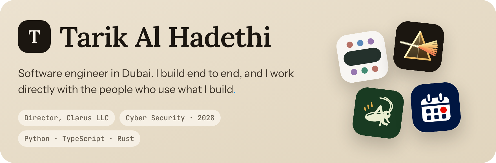
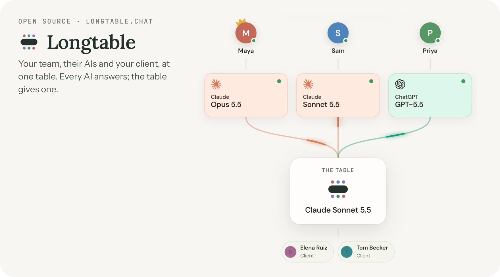
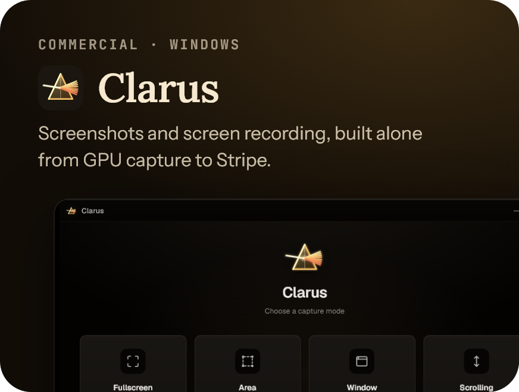
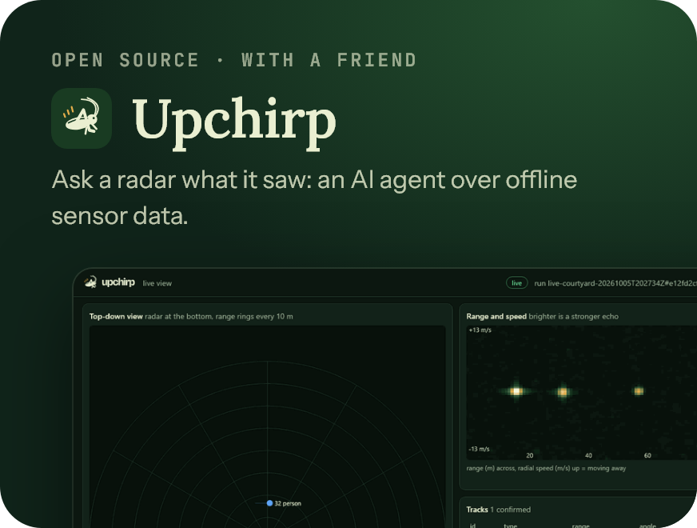
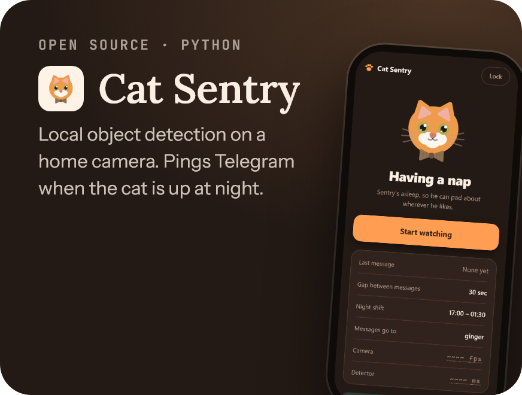
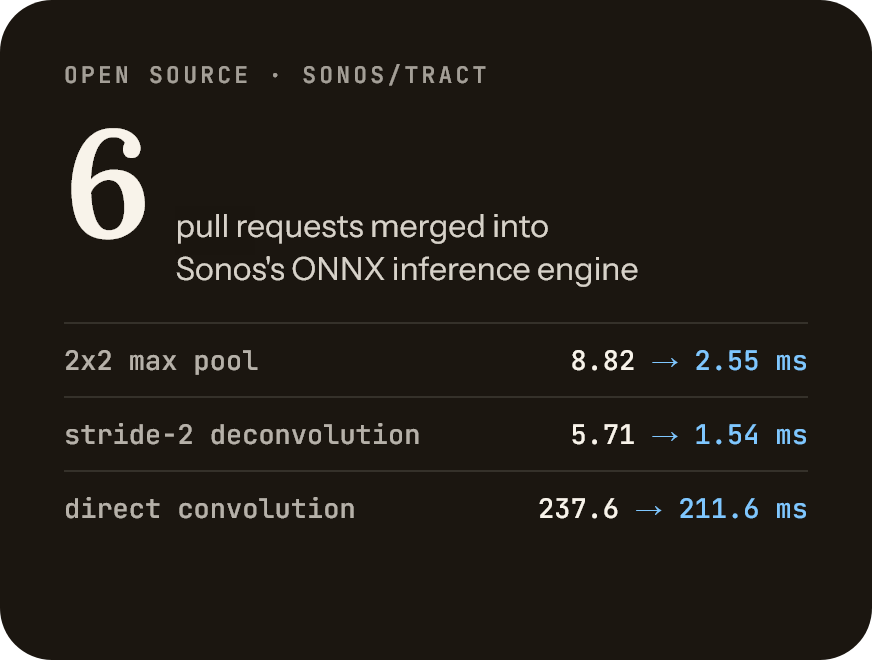
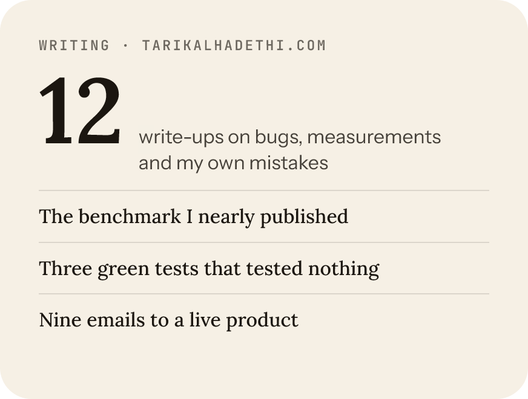

 

 

 

<a href="https://tarikalhadethi.com">tarikalhadethi.com</a> · <a href="https://www.linkedin.com/in/tarikalhadethi">LinkedIn</a> · tarikalhadethi@gmail.com

Open source, with links

- **[sonos/tract](https://github.com/sonos/tract)**: a shape bug where `1/2` read as 0 ([#2724](https://github.com/sonos/tract/issues/2724)), fixed in [#2730](https://github.com/sonos/tract/pull/2730) and [#2734](https://github.com/sonos/tract/pull/2734); four measured kernel slices co-authored with their original contributor ([#2829](https://github.com/sonos/tract/pull/2829), [#2830](https://github.com/sonos/tract/pull/2830), [#2831](https://github.com/sonos/tract/pull/2831), [#2916](https://github.com/sonos/tract/pull/2916)).
- **[crabnebula-dev/drag-rs](https://github.com/crabnebula-dev/drag-rs)**: a drag that never returns wedges the whole app ([#94](https://github.com/crabnebula-dev/drag-rs/issues/94)), with an opt-in timeout in [#95](https://github.com/crabnebula-dev/drag-rs/pull/95).
- **[tauri-apps/tao](https://github.com/tauri-apps/tao)**: a window minimised with Win+D loses that state on the next style change ([#1318](https://github.com/tauri-apps/tao/issues/1318)).

